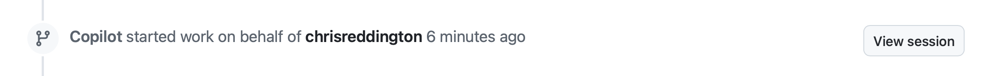

| [← Lección anterior: Instrucciones personalizadas][previous-lesson] |
|:--|

Es probable que muy pocas organizaciones —si es que hay alguna— no tengan problemas de deuda técnica. Puede tratarse de problemas de seguridad sin resolver, código heredado que necesita actualizarse o solicitudes de funcionalidades que llevan tiempo en el backlog por falta de tiempo para implementarlas. El agente de GitHub Copilot en la nube está diseñado para realizar tareas como actualizar código y añadir funcionalidades de forma autónoma. Cuando termina, crea un borrador de solicitud de incorporación de cambios (PR) para que un desarrollador lo revise. Así puedes delegar tareas tediosas, acelerar el desarrollo y centrarte en cuestiones de mayor alcance.

Con el agente de Copilot en la nube explorarás:

- cómo personalizar el entorno de generación de código.
- cómo garantizar que las operaciones se realicen de forma segura.
- la importancia de definir incidencias con un alcance claro.
- cómo asignar incidencias a Copilot.

## Escenarios

Tailspin Toys tiene deuda técnica que quiere resolver. Los contratistas que crearon la primera versión del sitio dejaron la documentación en mal estado: comprobarás que, de hecho, falta por completo. Como primer paso, el equipo quiere añadir comentarios de documentación TSDoc a todas las funciones exportadas de la aplicación.

Además, el equipo de diseño quiere mejorar el descubrimiento de juegos. Quiere mostrar juegos relacionados —otros títulos de la misma categoría— en la página de detalles de cada juego para que la gente pueda seguir explorando. Por ahora no necesita una implementación refinada; solo quiere algo que pueda utilizar para probar y aceptar la experiencia de usuario. Este trabajo bloquea otras tareas, pero hay incidencias que ahora mismo tienen más prioridad.

Estas tareas pueden quedar relegadas fácilmente y son buenas candidatas para asignarlas al agente de Copilot en la nube. El agente puede trabajar en ellas de forma asíncrona mientras el desarrollador se ocupa de otras tareas y, después, revisar su trabajo y comprobar que todo sea correcto.

## Introducción al agente de GitHub Copilot en la nube

El [agente de GitHub Copilot en la nube](https://docs.github.com/copilot/concepts/agents/cloud-agent/about-cloud-agent#overview-of-copilot-cloud-agent-formerly-copilot-coding-agent) puede realizar tareas en segundo plano de forma parecida a un desarrollador. Al igual que con el trabajo de otra persona, hay varias formas de asignarle una tarea, entre ellas [asignarle una incidencia de GitHub a Copilot](https://docs.github.com/copilot/how-tos/use-copilot-agents/cloud-agent/start-copilot-sessions). Cuando se la asignas, Copilot crea un borrador de solicitud de incorporación de cambios para registrar el progreso, configura un entorno y empieza a trabajar. Puedes consultar la sesión mientras sigue en curso o después de que termine. Cuando la solución propuesta esté lista para revisión, Copilot te mencionará en la solicitud de incorporación de cambios.

## La importancia de definir bien el alcance

GitHub Copilot no hace magia: no puedes saltarte el análisis. Incluso las tareas que parecen sencillas pueden ser complejas cuando se examinan en detalle, así que [define cuidadosamente el alcance de las tareas para el agente de Copilot en la nube][cloud-agent-best-practices]. Trátalo como un compañero de programación con IA: trabaja por etapas, aprende, experimenta y adapta el enfoque. La IA generativa no cambia los fundamentos del desarrollo de software.

## Instrucciones personalizadas de este repositorio

En ejercicios anteriores hemos presentado las instrucciones personalizadas y cómo guían a Copilot. Si ya completaste el ejercicio práctico sobre instrucciones personalizadas, has visto cómo funciona `.github/copilot-instructions.md`; si no, este es un buen momento para echarle un vistazo. Antes de asignar trabajo al agente de Copilot en la nube, revisa los archivos de instrucciones que ya incluye este repositorio. Así podrás observar su efecto más adelante.

Abre los siguientes archivos en la interfaz web de GitHub o en un Codespace, si ya tienes uno iniciado:

- `.github/copilot-instructions.md`: revisa la sección **Code standards**, especialmente las convenciones de TypeScript y los comentarios de documentación TSDoc.
- `.github/instructions/unit-tests.instructions.md`: fíjate en el frontmatter `applyTo`, que limita estas instrucciones a los archivos `**/*.test.ts`.

Cuando en la sección siguiente asignes al agente en la nube la incidencia `Code lacks documentation`, revisa la solicitud de incorporación de cambios resultante y busca los comentarios TSDoc, las convenciones de TypeScript y los encabezados de comentario. Estas directrices proceden de los archivos de instrucciones, y volveremos a mencionarlas al revisar las PR en un ejercicio posterior.

## Configura el entorno de desarrollo para el agente de Copilot en la nube

La creación de código suele requerir un entorno específico y algunos scripts de configuración para garantizar que todo esté listo, independientemente de quién realice el trabajo. Lo mismo ocurre al asignar tareas a Copilot, que trabaja de forma parecida a un ingeniero de software.

El agente en la nube utiliza [GitHub Actions][github-actions] como entorno de trabajo. Puedes personalizarlo mediante un [flujo de trabajo de configuración especial][setup-workflow], definido en `.github/workflows/copilot-setup-steps.yml`, que se ejecuta antes de que empiece el trabajo. Así se proporcionan las herramientas y dependencias necesarias. Este flujo ya está configurado para que el taller avance sin problemas y sirva como experiencia de aprendizaje. Proporciona a Copilot Node.js, las dependencias del proyecto, los navegadores necesarios para las pruebas de extremo a extremo y la base de datos SQLite migrada y precargada de la aplicación Astro:

```yaml
name: "Copilot Setup Steps"

# Allows you to test the setup steps from your repository's "Actions" tab
on: workflow_dispatch

env:
  ASTRO_TELEMETRY_DISABLED: "1"

jobs:
  copilot-setup-steps:
    runs-on: ubuntu-latest
    # Set the permissions to the lowest permissions possible needed for *your steps*. Copilot will be given its own token for its operations.
    permissions:
      # If you want to clone the repository as part of your setup steps, for example to install dependencies, you'll need the `contents: read` permission. If you don't clone the repository in your setup steps, Copilot will do this for you automatically after the steps complete.
      contents: read
    steps:
      - name: Checkout code
        uses: actions/checkout@v5

      # Frontend / app setup - Node.js (the whole app is now Astro + Drizzle/libSQL)
      - name: Set up Node.js
        uses: actions/setup-node@v6
        with:
          node-version: "lts/*"
          cache: "npm"
          cache-dependency-path: "./package-lock.json"

      - name: Install JavaScript dependencies
        run: npm ci

      - name: Install Playwright browsers
        run: npx playwright install --with-deps chromium

      # Migrate + seed the local SQLite database so builds and tests have data.
      - name: Set up the database
        run: npm run db:setup
```

El archivo se parece a cualquier otro flujo de trabajo de GitHub, pero tiene algunos aspectos importantes:

- Contiene un único trabajo llamado `copilot-setup-steps`. Se ejecuta en GitHub Actions antes de que Copilot empiece a trabajar en la solicitud de incorporación de cambios.
- Observa el desencadenador `workflow_dispatch`, que permite ejecutar el flujo de trabajo manualmente desde la pestaña **Actions** del repositorio. Es útil para comprobar que funciona correctamente sin esperar a que Copilot lo ejecute.

## Añade documentación

Aunque todos reconocemos la importancia de la documentación, muchos proyectos tienen información obsoleta o carecen de ella. Esta deuda técnica suele quedar desatendida, reduce la productividad y dificulta mantener el código o incorporar a nuevos desarrolladores. Copilot es especialmente útil para crear documentación, así que esta es una incidencia ideal para asignarle al agente de Copilot en la nube. El agente trabajará en segundo plano para generar la documentación necesaria. En un ejercicio posterior volverás a revisar su trabajo.

1. Abre una pestaña nueva del navegador y visita el repositorio en github.com.
2. Selecciona la pestaña **Issues**.
3. Selecciona **New issue** para abrir el cuadro de diálogo de incidencias.
4. Selecciona **Blank issue** para crear una incidencia vacía.
5. Escribe `Code lacks documentation` en **Title**.
6. Escribe lo siguiente en **Description**:

    ```plaintext
    Our organization has a requirement that functions and methods include TSDoc doc comments where helpful. Unfortunately, recent updates haven't followed this standard. We need to update the existing code to ensure doc comments are included where they clarify behavior.
    ```

7. Selecciona **Create** para crear la incidencia.
8. A la derecha, selecciona **Assign to Copilot** para abrir el cuadro de diálogo de asignación.

  

9. Selecciona **Assign**.

  

10. Selecciona la pestaña **Pull Requests**.
11. Abre la solicitud de incorporación de cambios (PR) nueva, cuyo título será similar a `[WIP]: Code lacks documentation`. Si aún no aparece en la lista, espera un momento y actualiza la ventana del navegador.
12. Al cabo de unos minutos, Copilot debería haber creado una lista de tareas.

> [!NOTE]
> La lista puede tardar varios minutos en aparecer en la PR. Copilot está preparando su entorno (ejecutando el flujo de trabajo que acabas de revisar), analizando el proyecto y determinando el mejor enfoque para la tarea.

13. Revisa la lista y las tareas que va a completar.
14. Desplázate hacia abajo por la cronología de la PR. Deberías ver una actualización que indica que Copilot ha empezado a trabajar en la incidencia.
15. Selecciona el botón **View session**.

  

> [!CAUTION]
> Puede que tengas que actualizar la ventana para ver el indicador actualizado.

16. Observa que puedes recorrer la sesión en directo y ver cómo Copilot resuelve el problema: explora el código y comprende el estado del proyecto, se detiene a analizar y decidir el plan adecuado y crea código.

El proceso puede tardar varios minutos. Uno de los objetivos principales del agente de Copilot en la nube es permitirle trabajar de forma asíncrona para que podamos ocuparnos de otras tareas. Aprovecharemos esa capacidad asignándole otra tarea mientras nos ponemos a añadir funcionalidades a la aplicación.

## Añade una sección de juegos relacionados a la página de detalles

Una de las grandes ventajas del agente de Copilot en la nube es que permite repartir el trabajo para que tú te centres en unas tareas mientras el agente se ocupa de otras. Aunque añadir una sección de juegos relacionados para el equipo de diseño no debería llevar mucho tiempo, podrías aprovechar ese tiempo para otras tareas. Vamos a asignársela al agente de Copilot en la nube.

1. Vuelve al repositorio en github.com.
2. Selecciona la pestaña **Issues**.
3. Selecciona **New issue** para abrir el cuadro de diálogo de incidencias.
4. Selecciona **Blank issue** para usar la plantilla vacía.
5. Escribe `Show related games on the game details page` en **Title**.
6. Escribe lo siguiente en **Description**:

    ```markdown
    We want to help people discover more games by showing related games on each game's details page. The design team wants to explore the UX and do some acceptance testing. Our requirements are:

   - Add a data-access helper in `src/lib/` that returns other games in the same category as a given game, excluding that game
   - Show a "Related games" section on the game details page that uses the helper
   - Handle the case where a game has no related games
   - There should be unit tests created for the new helper
   - Before creating the PR, ensure all tests pass
   ```

7. Selecciona **Create** para crear la incidencia.
8. A la derecha, selecciona **Assign to Copilot** para abrir el cuadro de diálogo de asignación.

  

9. Selecciona **Assign**.

Poco después verás el emoji 👀 en el primer comentario de la incidencia. Indica que Copilot ya está trabajando.


Copilot ya está trabajando en la segunda solicitud. El agente de Copilot en la nube funciona de forma parecida a un ingeniero de software: no hace falta supervisarlo continuamente, puedes revisar el resultado cuando termine. Ahora vamos a crear y usar agentes personalizados.

## Resumen y próximos pasos

En esta lección has explorado el [agente de GitHub Copilot en la nube][copilot-agents]. Puedes asignarle incidencias para que trabaje en ellas de forma asíncrona. Copilot puede resolver deuda técnica, crear funcionalidades o ayudar a migrar código de un framework a otro.

Has explorado estos conceptos:

- personalizar el entorno de generación de código.
- garantizar que las operaciones se realicen de forma segura.
- definir incidencias con un alcance claro.
- asignar incidencias a Copilot.

Mientras el agente en la nube trabaja, puedes crear y usar agentes personalizados. El [agente de Copilot en la nube también puede usar servidores MCP][cloud-agent-mcp] y acceder a las instrucciones personalizadas que exploramos en módulos anteriores.

## Recursos

- [Acerca del agente de Copilot en la nube][copilot-agents]
- [Asignar incidencias de GitHub a Copilot][assign-issue]
- [Prácticas recomendadas para el flujo de configuración del agente en la nube][cloud-agent-best-practices]

| [Siguiente lección: Agentes personalizados →][next-lesson] |
|--:|

[previous-lesson]: ../1-custom-instructions/
[next-lesson]: ../3-custom-agents/
[cloud-agent-mcp]: https://docs.github.com/copilot/how-tos/copilot-on-github/customize-copilot/customize-cloud-agent/extend-cloud-agent-with-mcp
[assign-issue]: https://docs.github.com/copilot/how-tos/use-copilot-agents/cloud-agent/start-copilot-sessions
[setup-workflow]: https://docs.github.com/copilot/how-tos/copilot-on-github/customize-copilot/customize-cloud-agent/customize-the-agent-environment
[copilot-agents]: https://docs.github.com/copilot/concepts/agents/cloud-agent/about-cloud-agent
[cloud-agent-best-practices]: https://docs.github.com/copilot/how-tos/copilot-on-github/customize-copilot/customize-cloud-agent/customize-the-agent-environment
[github-actions]: https://docs.github.com/actions
